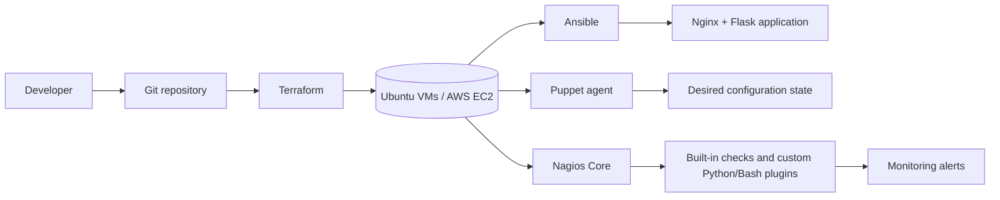
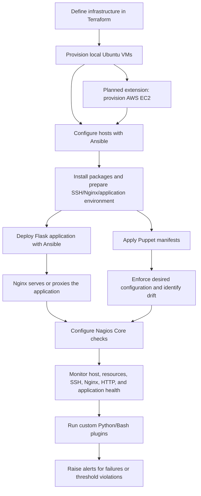

# AutoOps: Automated Infrastructure Provisioning, Configuration Management & Continuous Monitoring

> **Project status:** Under development. The repository currently contains the project synopsis only. The architecture and implementation steps described below distinguish the proposed design from work that is currently evidenced in the repository.

## Project Introduction

AutoOps is a proposed integrated DevOps engineering framework for automating infrastructure provisioning, server configuration, application deployment, configuration-state enforcement, and continuous monitoring.

The project brings together Terraform, Ansible, Puppet, Nagios Core, AWS EC2, Ubuntu Linux, Python, Flask, Bash, Nginx, Git, and GitHub in one coordinated workflow. A lightweight Flask application is intended to provide a practical deployment and monitoring target.

The current project synopsis defines the intended methodology and expected outcomes. It does not provide implementation files yet; therefore, the implementation status of each module is marked explicitly throughout this document.

## Problem Statement

Manual infrastructure administration requires repeated work such as provisioning machines, installing software, configuring services, deploying applications, and checking system health. As the number of systems increases, these activities can cause:

- Configuration inconsistencies between servers.
- Human error and non-reproducible environments.
- Slow or inconsistent application deployments.
- Configuration drift after a server has been provisioned.
- Delayed detection of infrastructure and application failures.
- Disconnected workflows when provisioning, configuration, deployment, and monitoring tools are used independently.

AutoOps addresses this problem through a coordinated automation workflow that is intended to provision infrastructure, configure servers, enforce desired state, deploy a sample application, and continuously monitor services and resources.

## Why AutoOps?

AutoOps demonstrates how complementary DevOps tools can be used for their appropriate responsibilities instead of treating infrastructure automation as a single task:

1. **Terraform** defines infrastructure as code and provisions the required resources.
2. **Ansible** performs repeatable server preparation and application deployment.
3. **Puppet** maintains the desired configuration state and helps detect or correct drift.
4. **Nagios Core** monitors hosts, services, resources, and application health.
5. **Flask and Nginx** provide a small, observable application deployment target.

This separation of responsibilities makes the proposed workflow easier to understand, test, reproduce, and extend.

## Project Objectives

- Automate infrastructure provisioning with Terraform.
- Automate server configuration and software installation with Ansible.
- Maintain consistent server configuration with Puppet.
- Demonstrate configuration drift detection and correction.
- Deploy a Flask web application using Ansible.
- Use Nginx as the web server and proposed reverse proxy.
- Monitor server availability and resource utilization.
- Monitor SSH, Nginx, HTTP, and application health.
- Develop custom Nagios monitoring plugins in Python and Bash.
- Integrate Terraform, Ansible, Puppet, and Nagios into a coordinated workflow.
- Reduce repetitive administration and improve deployment consistency.

## Key Features

| Capability | Intended responsibility | Status |
|---|---|---|
| Infrastructure as Code | Define and provision infrastructure with Terraform | Planned |
| Server preparation | Install packages and prepare hosts with Ansible | Planned |
| Desired-state enforcement | Maintain packages, services, files, directories, and permissions with Puppet | Planned |
| Application deployment | Deploy a Flask application and configure Nginx with Ansible | Planned |
| Continuous monitoring | Monitor hosts, services, resources, and application health with Nagios Core | Planned |
| Custom checks | Add Python and Bash plugins for resource and application checks | Planned |
| Local validation | Develop and test initially on local Ubuntu virtual machines | Planned |
| Cloud deployment | Extend validation to AWS EC2 instances | Planned |

No implementation feature is marked as implemented because the inspected project root contains only the synopsis documents.

## Technology Stack

| Technology | Why it is used in AutoOps |
|---|---|
| **Terraform** | Infrastructure as Code for defining repeatable infrastructure resources, including the proposed virtual machines or AWS resources, networking, and security groups. |
| **Ansible** | Agentless automation for initial server configuration, package installation, SSH preparation, Nginx setup, application environment preparation, and Flask deployment. |
| **Puppet** | Desired-state configuration management for keeping packages, services, directories, permissions, and configuration files consistent over time. |
| **Nagios Core** | Continuous host and service monitoring, alerting, and failure detection for infrastructure and application components. |
| **AWS EC2** | Proposed cloud compute platform for hosting the infrastructure after local validation. |
| **Ubuntu Linux** | Proposed server operating system for the development and deployment environment. |
| **Python** | Flask application development and custom Nagios monitoring plugins. |
| **Flask** | Lightweight sample web application used to demonstrate automated deployment and application health monitoring. |
| **Bash** | Supporting automation scripts and monitoring checks. |
| **Nginx** | Web server and proposed reverse proxy in front of the Flask application. |
| **Git and GitHub** | Version control, collaboration, and project documentation. No remote repository or push operation is configured in the inspected folder. |

## System Architecture

The following is the **proposed** architecture based on the project synopsis. It is not a record of currently deployed infrastructure.



### Architecture Responsibilities

- **Terraform** is the infrastructure layer. It should define resources and their relationships without managing application configuration.
- **Ansible** is the orchestration and deployment layer. It should prepare hosts and deploy the Flask application through reusable playbooks.
- **Puppet** is the ongoing configuration-management layer. It should enforce the desired state of managed resources and expose configuration drift.
- **Nagios Core** is the observability layer. It should check availability, services, resource thresholds, and application health, then report failures through its alerting mechanisms.
- **Nginx and Flask** form the sample application path that allows deployment and HTTP health checks to be demonstrated.

## Complete Project Workflow

The proposed end-to-end workflow is:



1. Terraform defines the target infrastructure.
2. Terraform provisions the initial local environment; AWS EC2 is a planned later target according to the synopsis.
3. Ansible connects to the hosts and performs initial configuration.
4. Ansible installs required packages, prepares SSH access, configures Nginx, and prepares the application environment.
5. Puppet applies manifests to enforce packages, services, directories, permissions, and configuration files.
6. Ansible deploys the Flask application.
7. Nginx serves the application or acts as its reverse proxy.
8. Nagios Core monitors host availability, CPU, memory, disk, SSH, Nginx, HTTP, and application health.
9. Custom Python and Bash plugins extend the standard checks.
10. Failures, drift, and threshold violations are evaluated through testing and monitoring alerts.

## Module Descriptions

### Terraform Infrastructure Provisioning

**Status: Planned**

Terraform is intended to describe infrastructure declaratively. The proposed scope includes virtual machines or AWS EC2 instances, networking, and security groups. Terraform should make infrastructure reproducible and provide a clear starting point for the configuration workflow.

The synopsis states that development will initially use local Ubuntu virtual machines to control cloud costs, followed by AWS EC2 deployment after successful local implementation. No Terraform files are currently present in the repository.

### Ansible Configuration Automation

**Status: Planned**

Ansible is intended to perform host preparation through reusable playbooks. Planned responsibilities include:

- Installing required system packages.
- Preparing SSH access.
- Configuring Nginx.
- Preparing the Flask application environment.
- Deploying the Flask application.

No Ansible inventory, playbook, role, or variable files are currently present in the repository.

### Puppet Configuration Management

**Status: Planned**

Puppet is intended to maintain the desired state of managed servers after initial preparation. Planned managed resources include packages, services, directories, permissions, and configuration files.

Configuration-drift validation is expected to include deliberately modifying a managed configuration and observing Puppet's enforcement or correction behavior. No Puppet manifests, modules, or environment files are currently present in the repository.

### Nagios Continuous Monitoring

**Status: Planned**

Nagios Core is intended to continuously monitor infrastructure and application health. Planned checks include:

- Host availability.
- CPU utilization.
- Memory consumption.
- Disk usage.
- SSH connectivity.
- Nginx service status.
- HTTP availability.
- Flask application health.

Custom Python and Bash plugins are also planned. No Nagios configuration or plugin files are currently present in the repository.

### Flask Application Deployment

**Status: Planned**

A lightweight Flask application is intended to be deployed with Ansible behind Nginx. The synopsis proposes endpoints for health checks, server information, and version identification. These endpoints are useful monitoring targets, but they are not implemented in the currently inspected repository.

## Proposed Repository Structure

The current root contains only the two synopsis files listed below. The structure that follows is a **proposed target structure**, not a claim that these directories already exist.

```text
Devops_Project_7thsem/
├── README.md                         # Project documentation
├── Project_Synopsis.docx             # Existing project synopsis
├── Project_Synopsis.pdf              # Existing project synopsis PDF
├── terraform/                        # Planned Terraform configurations
│   ├── main.tf
│   ├── variables.tf
│   ├── outputs.tf
│   └── environments/
├── ansible/                          # Planned inventories, playbooks, roles, and variables
│   ├── inventory/
│   ├── playbooks/
│   ├── roles/
│   └── group_vars/
├── puppet/                           # Planned manifests and modules
│   ├── manifests/
│   └── modules/
├── nagios/                           # Planned Nagios host/service configuration
│   ├── hosts/
│   ├── services/
│   └── plugins/
├── app/                              # Planned Flask application
├── scripts/                          # Planned Bash automation helpers
└── tests/                            # Planned validation and failure-scenario tests
```

The proposed names are illustrative and should be adjusted when implementation files are added.

## Development Environment and Prerequisites

### Intended Environment

Based on the synopsis, the initial development and testing environment is expected to use local Ubuntu virtual machines. AWS EC2 is a planned subsequent deployment target.

### Prerequisites

The following tools are expected to be required when implementation begins:

- Ubuntu Linux or an Ubuntu virtual machine.
- Terraform.
- Ansible.
- Puppet.
- Nagios Core.
- Python and Flask.
- Bash.
- Nginx.
- Git.
- Optional AWS account and credentials for the planned EC2 phase.

Exact versions, package commands, network requirements, VM provider, AWS region, instance sizes, and security-group rules are not specified in the current repository. They should be documented after the implementation environment is selected and verified.

## Installation and Setup

### Current Verified State

The only verified repository contents are:

1. `Project_Synopsis.docx`
2. `Project_Synopsis.pdf`
3. This `README.md`

There are currently no verified application, Terraform, Ansible, Puppet, Nagios, or script entry points to install or run.

### Planned Setup

The following sequence is planned and should be completed only after the corresponding files and environment are implemented:

1. Create or prepare Ubuntu virtual machines.
2. Install and verify Terraform, Ansible, Puppet, Nagios Core, Python, Flask, Nginx, Bash, and Git.
3. Add Terraform configuration and provision the local infrastructure.
4. Add Ansible inventory and playbooks, then configure the provisioned hosts.
5. Add Puppet manifests and modules, then apply the desired state.
6. Add the Flask application and deploy it using Ansible.
7. Configure Nginx as the application web server or reverse proxy.
8. Configure Nagios Core and install custom monitoring plugins.
9. Execute the testing and failure scenarios described below.
10. Extend the validated setup to AWS EC2 if required.

These are planned steps, not verified installation instructions for the current repository.

## Testing Strategy and Failure Scenarios

Testing should validate each layer independently and then validate the integrated workflow.

| Test area | Scenario | Expected result |
|---|---|---|
| Terraform | Apply the infrastructure definition in a clean environment | Declared resources are created reproducibly; exact resources depend on the future implementation |
| Ansible | Run configuration playbooks on a newly prepared host | Required packages, services, directories, and application prerequisites are configured |
| Idempotency | Run the same Ansible playbook more than once | A subsequent run makes no unnecessary changes |
| Puppet | Modify a Puppet-managed configuration file or service state | Puppet detects and, where defined, corrects the drift |
| Application | Stop the Flask application or make its health endpoint unavailable | Application or HTTP monitoring reports a failure |
| Nginx | Stop or misconfigure Nginx | Nginx and HTTP checks report the failure |
| SSH | Make SSH unavailable or inaccessible | SSH monitoring reports the host/service problem |
| Resources | Exceed CPU, memory, or disk thresholds | The relevant custom or built-in Nagios check reports a threshold violation |
| Recovery | Restore the failed service or configuration | Monitoring returns to an operational state after the next valid check |

The exact commands, thresholds, fixtures, and expected exit codes should be added alongside the implementation. They cannot be verified from the current repository.

## Expected Outcomes

The proposed project is expected to demonstrate:

- Automated infrastructure provisioning through Terraform.
- Consistent server configuration through Ansible and Puppet.
- Deployment of a Flask-based web application.
- Continuous infrastructure and application monitoring through Nagios Core.
- Early detection of service failures and resource-related problems.
- Automated correction of selected configuration inconsistencies.
- A reproducible infrastructure-management workflow.
- Practical understanding of Infrastructure as Code, configuration management, deployment automation, and monitoring.

These are expected outcomes from the synopsis, not measured results.

## Course Syllabus Mapping

| Course outcome | AutoOps mapping |
|---|---|
| **CO1: Puppet fundamentals** | Introduces Puppet's role as a desired-state configuration-management tool and explains how manifests and modules fit into the workflow. |
| **CO2: Puppet configuration management** | Applies Puppet to packages, services, directories, permissions, and configuration files, including planned drift correction. |
| **CO3: Nagios monitoring** | Uses Nagios Core for host, service, resource, SSH, Nginx, HTTP, and application-health monitoring. |
| **CO4: Terraform infrastructure automation** | Defines infrastructure as code and provisions the proposed local or AWS-based infrastructure. |
| **CO5: Ansible fundamentals** | Uses Ansible's agentless model, inventories, variables, and reusable automation concepts for server preparation. |
| **CO6: Ansible playbooks** | Implements planned playbooks for package installation, Nginx setup, application preparation, and Flask deployment. |

## Future Enhancements

The synopsis identifies or implies the following future enhancements:

- GitHub Actions or another CI/CD integration.
- Docker-based application containerization.
- Centralized logging with the ELK Stack.
- Performance visualization with Prometheus and Grafana.
- Expansion from local Ubuntu virtual machines to AWS EC2.
- Additional monitoring checks and richer application health endpoints.
- More automated validation of infrastructure, configuration drift, deployment, and recovery.

## Project Status

**Overall status: In Progress / proposed implementation phase**

| Area | Evidence in inspected repository | Status |
|---|---|---|
| Project definition and objectives | `Project_Synopsis.docx` and `Project_Synopsis.pdf` | Documented |
| README documentation | This file | Implemented |
| Terraform provisioning | No Terraform files found | Planned |
| Ansible automation | No Ansible files found | Planned |
| Puppet management | No Puppet files found | Planned |
| Nagios monitoring | No Nagios files found | Planned |
| Flask application | No application files found | Planned |
| AWS deployment | No infrastructure or deployment files found | Planned |
| Tests and failure validation | No test files found | Planned |

This project should not be considered production-ready. Production use would require, at minimum, implemented and reviewed code, secure secret handling, tested rollback and recovery procedures, hardened access controls, CI validation, monitoring operational procedures, and environment-specific documentation.

## Author and Acknowledgements

**Author:** Riddhima Rai  
**Programme / Section:** B.Tech Computer Science Engineering / K2O2316  
**Course:** INT333 – DevOps Advanced Configuration Management

The project synopsis credits **Dr. Harpreet Kaur** as the submission recipient. The project is based on the practical integration of Terraform, Ansible, Puppet, Nagios Core, AWS EC2, Ubuntu Linux, Python, Flask, Bash, Nginx, Git, and GitHub.

