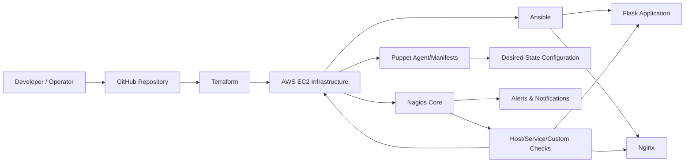
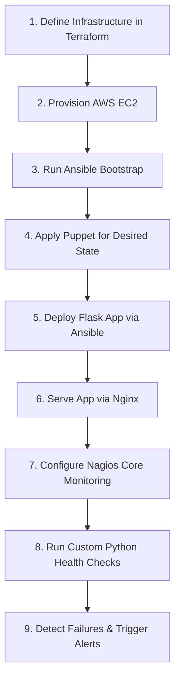

# AutoOps: Automated Infrastructure Provisioning, Configuration Management & Continuous Monitoring

## 1. Project Introduction
AutoOps is a DevOps engineering project focused on automating infrastructure provisioning, server configuration, application deployment, and continuous monitoring using industry-standard tools.

This repository is currently in an early setup stage. At the time of writing, the repository contains only the project README and does not yet include implementation directories or automation code.

## 2. Problem Statement
Modern infrastructure and application operations are often managed through disconnected manual steps. This leads to:
- Inconsistent server states across environments
- Slow and error-prone provisioning and deployment
- Configuration drift over time
- Delayed detection of infrastructure or application failures

AutoOps addresses this by proposing an integrated workflow that combines Infrastructure as Code (IaC), configuration management, deployment automation, and monitoring in one coordinated project.

## 3. Why AutoOps?
AutoOps is designed to demonstrate how multiple DevOps tools can be orchestrated together, not used in isolation:
- **Terraform** for reproducible infrastructure provisioning
- **Ansible** for agentless server setup and deployment
- **Puppet** for desired-state enforcement and drift control
- **Nagios Core** for continuous monitoring and alerting

This makes the project suitable for learning, portfolio demonstration, and structured implementation of end-to-end DevOps practices.

## 4. Project Objectives
- Automate infrastructure provisioning
- Automate server configuration and software installation
- Maintain consistent server configurations
- Detect and correct configuration drift
- Deploy a Flask web application using Ansible
- Monitor server availability and resource utilization
- Monitor Nginx, SSH, HTTP, and application health
- Develop custom Nagios monitoring plugins using Python
- Integrate Terraform, Ansible, Puppet, and Nagios into a coordinated workflow

## 5. Key Features
### Planned/Target Features
- Infrastructure provisioning on AWS EC2 using Terraform
- Base server bootstrap and package setup using Ansible
- Desired-state enforcement using Puppet manifests/modules
- Flask app deployment behind Nginx using Ansible
- Nagios Core monitoring for host/service health
- Custom Python monitoring plugins for CPU, memory, disk, and app checks

### Current Implementation Status (Evidence-based)
| Feature Area | Status | Evidence in Repository |
|---|---|---|
| Project documentation baseline | **Implemented** | `README.md` exists in repository root |
| Terraform code | **Planned** | No Terraform files/directories currently present |
| Ansible playbooks/inventory/roles | **Planned** | No Ansible files/directories currently present |
| Puppet manifests/modules | **Planned** | No Puppet files/directories currently present |
| Nagios configs/plugins | **Planned** | No Nagios files/directories currently present |
| Flask application code | **Planned** | No Flask application files currently present |

## 6. Technology Stack (with Purpose)
| Technology | Role in AutoOps | Why It Is Used |
|---|---|---|
| Terraform | Infrastructure provisioning (IaC) | Declarative, version-controlled cloud resource creation |
| Ansible | Configuration automation and deployment | Agentless orchestration over SSH; readable playbooks |
| Puppet | Configuration management | Desired-state enforcement and drift correction |
| Nagios Core | Monitoring and alerting | Mature host/service health checks and alert model |
| AWS EC2 | Compute infrastructure | Widely used cloud VM platform for IaC workflows |
| Ubuntu Linux | Server operating system | Common Linux target for automation and operations |
| Python + Flask | Sample deployable application and custom plugins | Lightweight app stack; Python is practical for plugin scripting |
| Bash | Operational scripting | Useful for glue automation and local orchestration |
| Git + GitHub | Version control and collaboration | Change tracking, collaboration, and review workflow |

## 7. System Architecture
> The diagram below represents the **proposed architecture**.



## 8. Complete Project Workflow
> This is the **planned execution flow** for end-to-end automation.



## 9. Individual Module Descriptions
### Terraform Infrastructure Provisioning
**Responsibility:** Define and provision cloud infrastructure resources (e.g., EC2, networking dependencies) in a declarative manner.

**Status:** Planned.

### Ansible Configuration Automation
**Responsibility:** Perform initial host configuration, package installation, service setup, and deployment orchestration over SSH.

**Status:** Planned.

### Puppet Configuration Management
**Responsibility:** Enforce desired configuration continuously and reduce configuration drift after initial setup.

**Status:** Planned.

### Nagios Continuous Monitoring
**Responsibility:** Monitor infrastructure and services (host health, SSH, HTTP, Nginx, app endpoints) and raise alerts on failure.

**Status:** Planned.

### Flask Application Deployment
**Responsibility:** Provide a sample deployable application for validating provisioning, deployment, and monitoring pipelines.

**Status:** Planned.

## 10. Proposed Repository Structure (Adapted to Current State)
### Current Repository Structure (Observed)
```text
AutoOps-Infrastructure-Automation/
└── README.md
```

### Proposed Structure as Implementation Expands
```text
AutoOps-Infrastructure-Automation/
├── README.md
├── terraform/
│   ├── main.tf
│   ├── variables.tf
│   └── outputs.tf
├── ansible/
│   ├── inventory/
│   ├── playbooks/
│   └── roles/
├── puppet/
│   ├── manifests/
│   └── modules/
├── monitoring/
│   ├── nagios/
│   └── plugins/
├── app/
│   ├── flask_app/
│   └── requirements.txt
└── scripts/
```

> Note: The proposed folders above are a roadmap view and are **not yet present** in the current repository.

## 11. Development Environment and Prerequisites
### Verified (Current Repository)
- Git installed
- Access to this repository
- Markdown viewer/editor for documentation updates

### Planned (When implementation files are added)
- Terraform CLI
- Ansible
- Puppet
- Nagios Core
- Python 3.x + pip
- AWS account and IAM credentials
- Ubuntu-based target servers/instances

## 12. Installation and Setup
### Verified Setup (Current State)
```bash
git clone <repository-url>
cd AutoOps-Infrastructure-Automation
```
Current contents are documentation-focused and do not yet include runnable infrastructure/app code.

### Planned Setup (Future Implementation)
1. Add Terraform configuration and initialize with `terraform init`
2. Create and validate Terraform execution plan
3. Provision infrastructure with Terraform apply workflow
4. Add Ansible inventory/playbooks and run bootstrap
5. Add Puppet manifests/modules for drift management
6. Add Flask app and Nginx deployment automation
7. Add Nagios configuration and custom plugin checks

## 13. Testing Strategy and Failure Scenarios
Because implementation modules are not yet in the repository, this section defines the intended testing strategy:

### Planned Testing Strategy
- **Terraform:** `fmt`, `validate`, and plan review checks
- **Ansible:** playbook syntax checks and idempotency verification
- **Puppet:** manifest validation and repeated-run consistency checks
- **Flask deployment:** service reachability and HTTP health checks
- **Nagios:** verify host/service checks and alert trigger behavior

### Planned Failure Scenarios to Validate
- EC2 instance unreachable
- SSH service unavailable
- Nginx process down
- Flask app endpoint failure
- High CPU/memory/disk thresholds breached
- Configuration drift introduced manually, then corrected

## 14. Expected Outcomes
- Reproducible infrastructure provisioning process
- Reduced manual configuration effort
- Consistent configuration state management
- Automated deployment flow for a sample web application
- Continuous visibility into infrastructure and application health
- Clear demonstration of integrated DevOps toolchain usage

## 15. Course Syllabus Mapping
| Course Outcome | Coverage in AutoOps |
|---|---|
| CO1: Puppet fundamentals | Planned module structure for Puppet-based state management |
| CO2: Puppet configuration management | Planned drift detection/correction workflow |
| CO3: Nagios monitoring | Planned host/service/application monitoring and alerting |
| CO4: Terraform infrastructure automation | Planned declarative cloud provisioning workflow |
| CO5: Ansible fundamentals | Planned inventory/playbook-driven configuration approach |
| CO6: Ansible playbooks | Planned deployment and automation playbook design |

## 16. Future Enhancements
- CI/CD integration for automated validation and deployment stages
- Multi-environment support (dev/stage/prod)
- Reusable module design for Terraform and Ansible roles
- Alert routing integrations (email/chat/incident tools)
- Security hardening and compliance checks in automation pipeline
- Observability expansion (metrics dashboards and log aggregation)

## 17. Project Status
**Status:** In Progress (Documentation and architecture definition stage)

- **Implemented now:** Initial repository documentation
- **In Progress:** Detailed design and module planning
- **Planned next:** Infrastructure and automation module implementation

## 18. Author and Acknowledgements
**Author:** Riddhima (Project Owner)

**Acknowledgements:**
- Open-source communities behind Terraform, Ansible, Puppet, Nagios, Flask, and Linux tooling
- Academic guidance and coursework context supporting this integrated DevOps project
